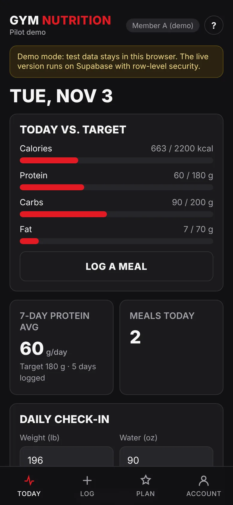
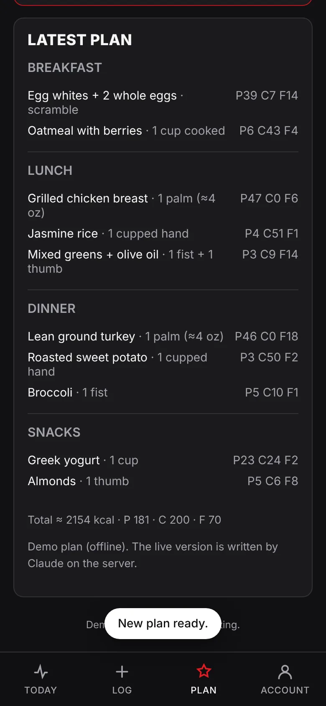
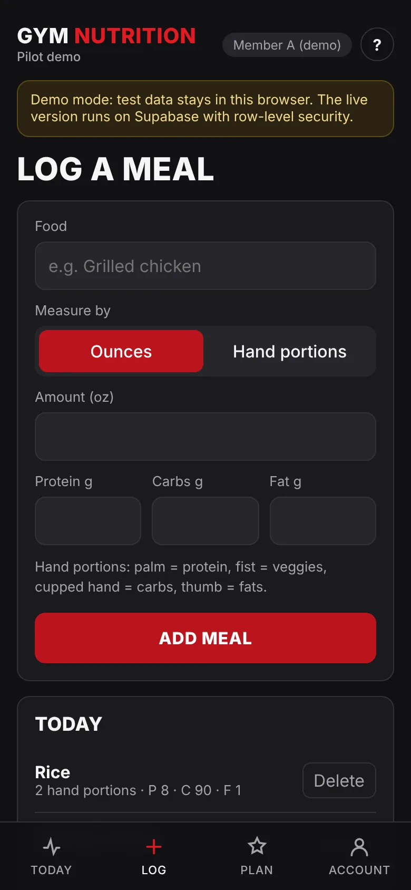
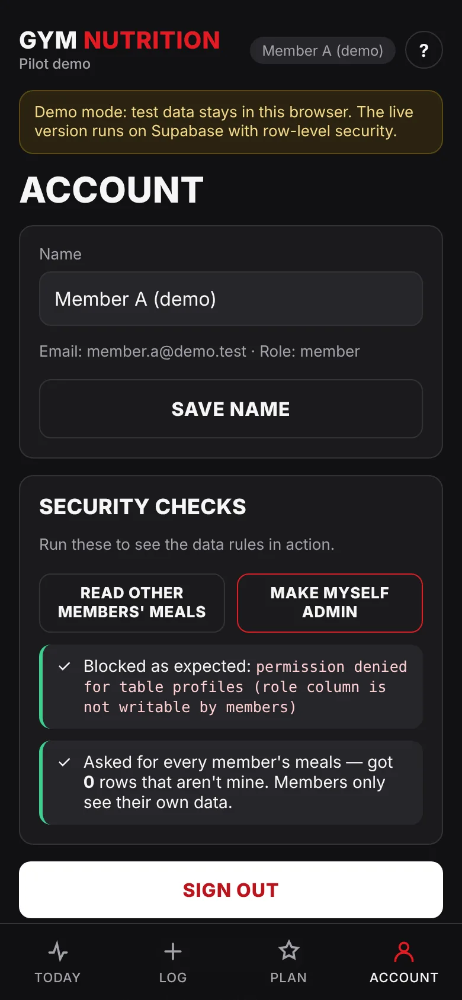
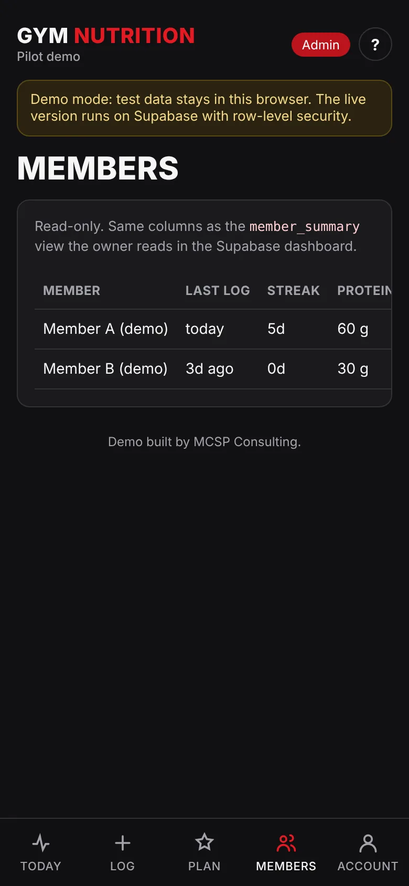
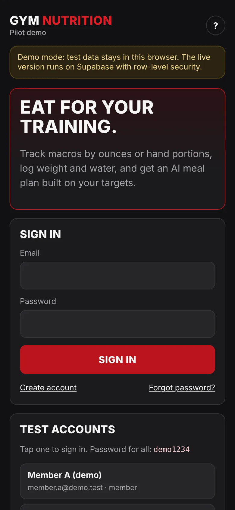

# Gym Nutrition: installable nutrition app for gym members (PWA)

Members set macro targets, log meals by ounces or hand portions, check in weight and water daily, and get a server-side AI meal plan capped at 3 per member per day. Coaches get a read-only member summary.

> Demo built by MCSP Consulting. Sample data only.

| Today vs. target | AI meal plan | Log a meal | Live security checks | Coach view | Sign in |
|---|---|---|---|---|---|
|  |  |  |  |  |  |

**Front end:** Vite + vanilla JS (22 KB, 7.5 KB gzipped, not counting the lazily loaded Supabase client), hand-written CSS, service worker and manifest via `vite-plugin-pwa`, iPhone safe-area padding, checked at 320 px wide.

**Back end:** Supabase Postgres with row-level security, and a Deno Edge Function that calls Claude.

**Tests:** `npm test` runs 10 rule checks (data isolation, no self-promotion, the 3-a-day AI cap, Chicago-time day boundaries, summary math). All pass.

## Two modes

| `VITE_DATA_MODE` | What runs | Needs |
|---|---|---|
| `mock` (default) | Everything in the browser with seeded test users. Same screens, same rules, offline meal plan. | Nothing |
| `supabase` | Real accounts, Postgres with row-level security, Claude via Edge Function | Supabase project + Anthropic key |

Mock mode is for showing the flow before the backend exists. It is **not** a security boundary — the data lives in the viewer's browser. The real protection is the SQL in `supabase/migrations/`.

**Test logins (mock):** `member.a@demo.test`, `member.b@demo.test`, `admin@demo.test` — password `demo1234`.

## Run locally

```bash
npm install
npm run dev        # http://localhost:5173
npm test           # rules: isolation, no self-promotion, 3/day cap, Chicago dates, summary math
npm run build      # outputs dist/ (static files + service worker)
```

## How the security works

- **RLS:** every member table has four policies — read own rows (or any row if `is_admin()`), insert/update/delete own rows only. `user_id` defaults to `auth.uid()`, and the insert check rejects any other value.
- **No self-promotion:** members have UPDATE on `profiles.full_name` only. The table-wide UPDATE grant is revoked, so `role` can't be changed from the app.
- **AI key:** lives only in Supabase secrets, used by `supabase/functions/generate-meal-plan`. The browser bundle never contains it (`grep -r "sk-ant" dist/` is empty).
- **AI cap:** `claim_ai_call()` atomically counts calls per member per Chicago day, plus a global daily ceiling. The 4th call gets HTTP 429. Macro targets are read from the database, not trusted from the request.
- **Summary view:** `member_summary` is readable in the Supabase dashboard only (revoked from the API). The in-app Members screen computes the same columns from rows the admin can read.

Use **Account → Security checks** in the app to demonstrate the isolation and role rules live.

## Go live with Supabase

1. Create a Supabase project. In Auth settings, turn off "Confirm email" for the demo.
2. `npm i -g supabase` → `supabase login` → `supabase link --project-ref <ref>`
3. `supabase db push` (applies `supabase/migrations/`)
4. Dashboard → Authentication → Users → add the 3 test users (auto-confirm), then run `supabase/seed.sql` in the SQL editor.
5. Secrets: `supabase secrets set ANTHROPIC_API_KEY=... ANTHROPIC_MODEL=<current small Claude model> AI_DAILY_LIMIT_PER_MEMBER=3 AI_DAILY_LIMIT_GLOBAL=100 ALLOWED_ORIGIN=https://<your demo domain>`
6. `supabase functions deploy generate-meal-plan`
7. On the host, set `VITE_DATA_MODE=supabase`, `VITE_SUPABASE_URL`, `VITE_SUPABASE_ANON_KEY` and rebuild.
8. Supabase → Auth → URL Configuration: add the demo URL as Site URL and redirect URL (password reset links).

## Deploy

- **Vercel:** import the repo, framework Vite, add the env vars above. `vercel.json` sets cache headers for the service worker.
- **Coolify / own VPS:** build with the `Dockerfile` (Vite build → nginx). Set the `VITE_*` values as **build** args — Vite bakes them in at build time.

PWA install: iPhone → Safari → Share → Add to Home Screen. Android → Chrome → Install app.

## Known limits (demo)

- If the Claude call fails after the cap is claimed, that call still counts.
- 7-day protein average is over logged days only (pending client preference).
- Account deletion, data export and Google sign-in are Phase 1 of the paid build, not in the demo.
- Supabase free projects pause when idle — open the demo every few days while it's in front of the client.
